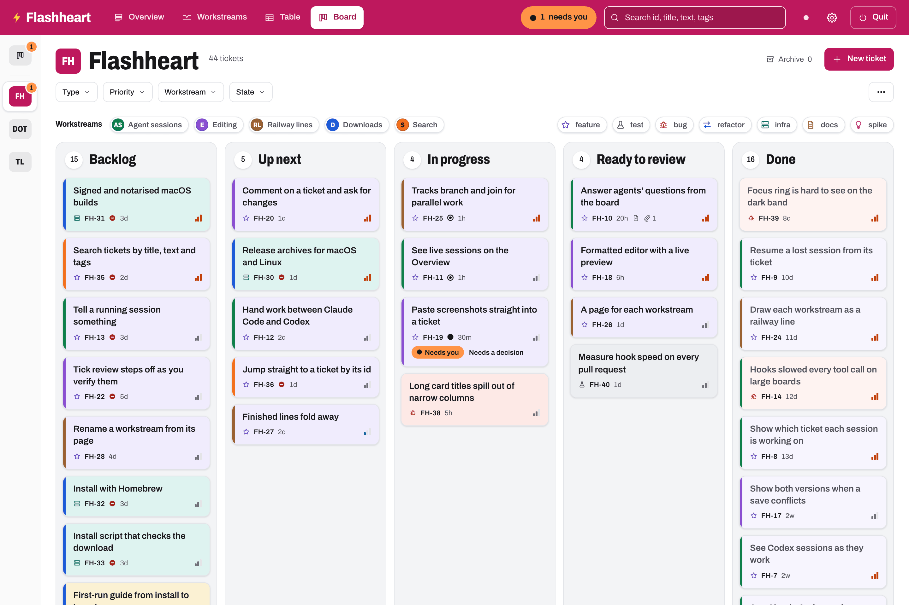
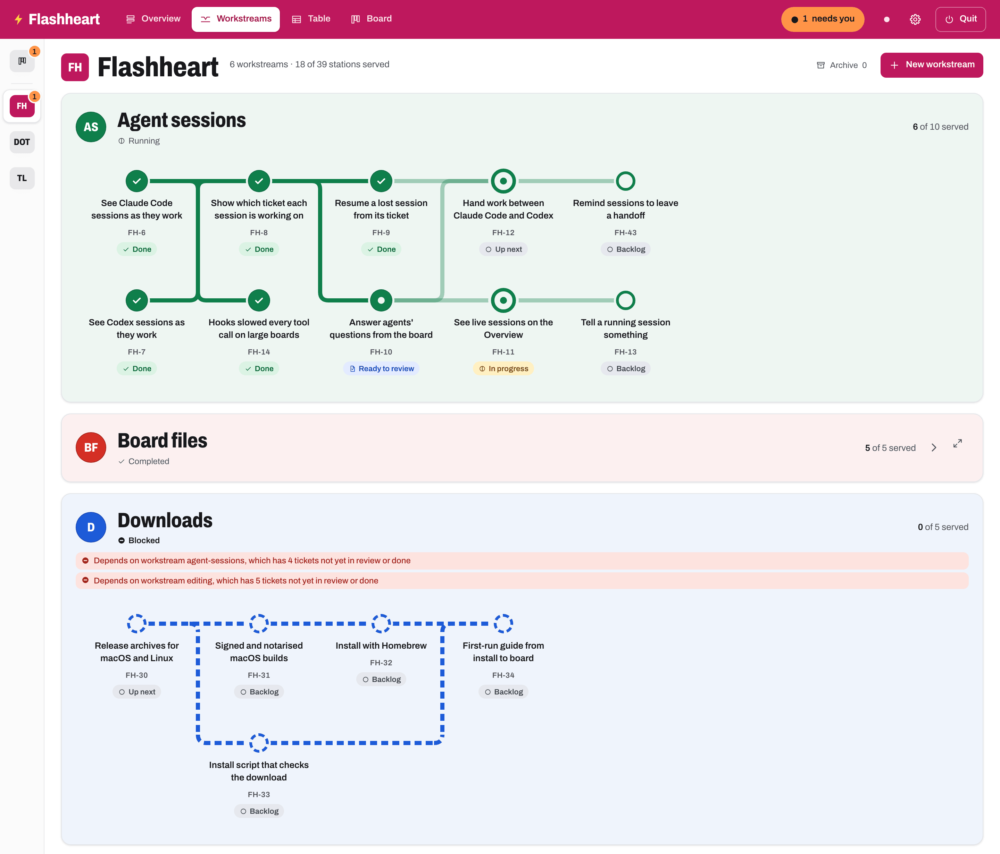
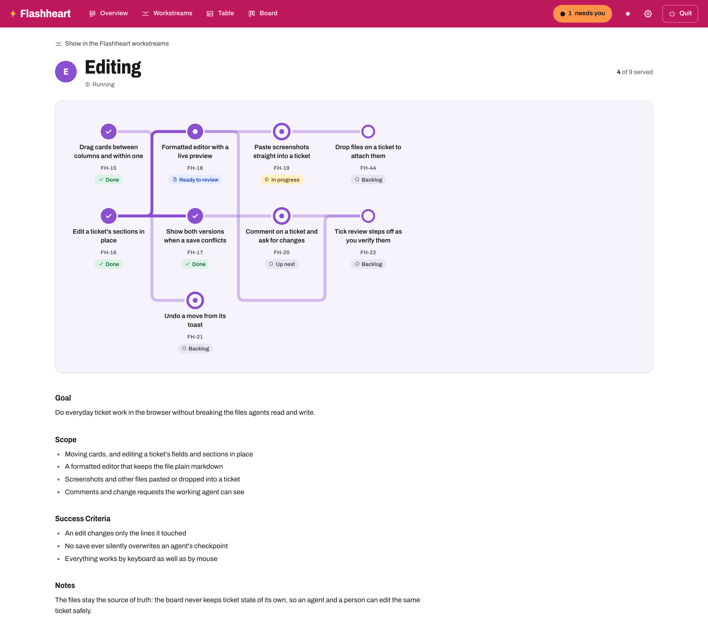
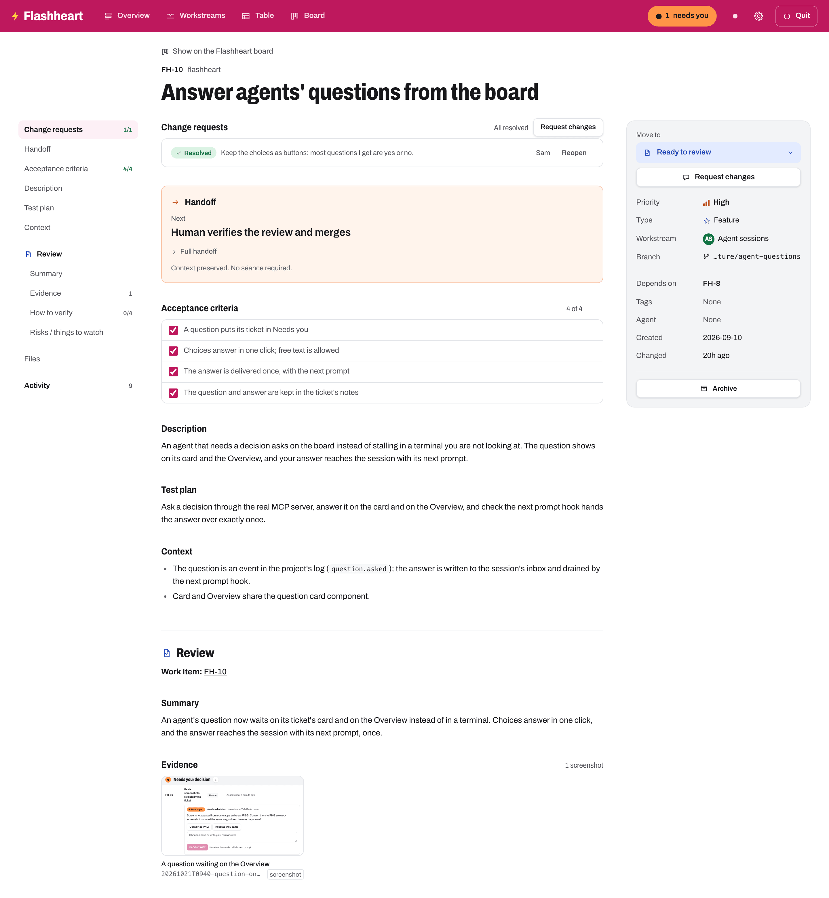
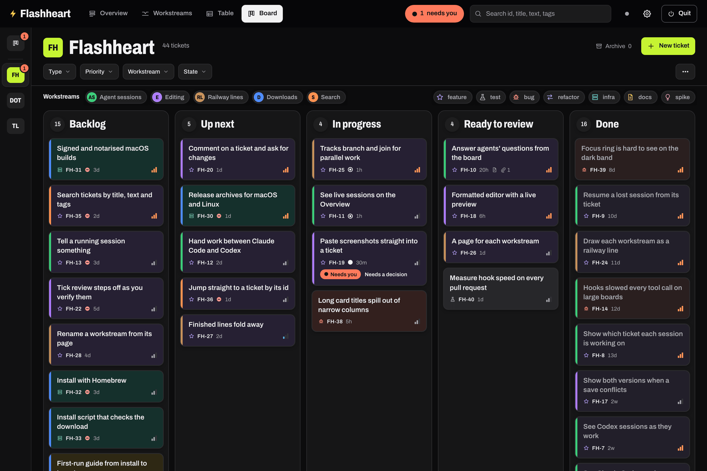

# Flashheart

> *"Woof!"*

**One local kanban board for every project you build with AI agents, that
the agents keep up to date themselves.**

You run Claude Code and Codex sessions across several repositories, often
in parallel and often unattended. Flashheart shows all of them on one board:
which agents are working, which have gone quiet, and which are waiting for
you. Agents find their work on the board, tick off acceptance criteria,
leave handoffs, ask you questions and write reviews, on the same tickets you
read. When a session dies, runs out of context or is replaced, the next one
(in either agent) is told where the work stood and carries on.

It is a single binary that runs on your machine. The tickets are plain
markdown files you own; nothing leaves your computer.



## Features

- **A board across all your projects.** Every repository gets its own
  project with a short ticket key (`FH-42`); a rail switches between them.
  Columns for Backlog, Up next, In progress, Ready to review and Done, a
  table view, filters and a **Needs you** chip that collects every session
  waiting on you.
- **Workstreams with dependency graphs.** Group tickets into workstreams
  (epics or milestones). Tickets and workstreams declare what they depend
  on, and the Workstreams view draws the whole plan as a railway map, so
  you can see what is blocked, what can run in parallel and what is next.
- **An Overview for the project manager in you.** Decisions, reviews
  waiting, risks and progress by ticket, with the sessions behind them as
  evidence, under a pipeline of the board's columns.
- **Agents report as they work.** Hooks record each session's lifecycle
  (start, edits, permission prompts, subagents, stop) with no effort from
  the model. Through the MCP server the agent claims tickets, ticks
  criteria, checkpoints its progress and files new tickets for follow-up
  work.
- **Sessions you can lose.** Each checkpoint rewrites the ticket's handoff:
  what is done, what is next, the files that matter and open questions. A
  new session is given the handoff when it starts and resumes from there.
- **Questions that reach you.** When an agent needs a decision it asks on
  the board, with its options. The card lights up as Needs you; your
  answer wakes the session.
- **Reviews with evidence.** Agents finish by writing a review guide with
  captioned screenshots and steps to verify, copied into the ticket. You
  request changes on the ticket page and the session picks them up; only
  you move a ticket to Done.
- **Claude Code and Codex.** One command connects each: the CLI, the IDE
  extensions and the desktop apps. Work started in one agent can be
  finished in the other.
- **Files are the truth.** Tickets are markdown with YAML frontmatter, one
  folder per ticket, readable in any editor or Obsidian and usable without
  Flashheart running. Edits made outside the board appear live.
- **Local and private.** A loopback-only server with authenticated
  requests, no telemetry, no accounts. Hooks never store your prompts,
  commands, or tool inputs and outputs, and text agents write is scrubbed
  of anything that looks like a secret.









## Easy setup

### 1. Download Flashheart

Prebuilt binaries for macOS (Apple silicon and Intel) and Linux (x86-64
and ARM) are on the
[Releases page](https://github.com/rztaylor/Flashheart/releases/latest),
named `flashheart_<version>_<os>_<arch>.tar.gz`, with a `SHA256SUMS` file.
To download the right one for this machine, check it and install it to
`~/.local/bin`:

```bash
os=$(uname -s | tr '[:upper:]' '[:lower:]'); arch=$(uname -m); case "$arch" in x86_64) arch=amd64 ;; aarch64) arch=arm64 ;; esac
version=$(curl -fsSL https://api.github.com/repos/rztaylor/Flashheart/releases/latest | sed -n 's/.*"tag_name": *"v\([^"]*\)".*/\1/p')
file="flashheart_${version}_${os}_${arch}.tar.gz"
curl -fsSLO "https://github.com/rztaylor/Flashheart/releases/download/v${version}/${file}"
curl -fsSLO "https://github.com/rztaylor/Flashheart/releases/download/v${version}/SHA256SUMS"
grep " ${file}\$" SHA256SUMS | shasum -a 256 -c -
tar -xzf "$file" && mkdir -p ~/.local/bin && mv flashheart ~/.local/bin/
```

With the GitHub CLI, `gh release download --repo rztaylor/Flashheart
--pattern "flashheart_*_${os}_${arch}.tar.gz" --pattern SHA256SUMS` does
the downloading. Make sure `~/.local/bin` is on your `PATH` (or put the
binary anywhere else that is), then check it runs:

```bash
flashheart version
```

On macOS, a binary downloaded **through a browser** is quarantined and
refused by Gatekeeper, because releases are not yet signed. Clear the flag
once:

```bash
xattr -d com.apple.quarantine ~/.local/bin/flashheart
```

Then open the board:

```bash
flashheart
```

It opens a private tab in your browser and gives you the terminal back. The
server stops when you choose **Quit** in the board or close its last tab.
Tickets live in `~/reports/Kanban` unless you pass `--root` or set
`FLASHHEART_ROOT`.

### 2. Connect your agents

Each `setup` command shows its changes as a diff, asks before writing and
backs up every file it changes. Run it again after moving the binary.

**Claude Code** (CLI, IDE extensions and the desktop app's Code tab):

```bash
flashheart setup claude
```

This adds Flashheart's hooks to `~/.claude/settings.json`, registers the
`flashheart` MCP server for every project and installs the Flashheart
skill, which tells the model when to claim, checkpoint, ask and finish.
Start a new session afterwards. Details:
[`docs/user/claude-code.md`](docs/user/claude-code.md).

**Codex** (CLI, IDE extension and the ChatGPT app):

```bash
flashheart setup codex
```

This adds the MCP server to `~/.codex/config.toml`, its hooks to
`hooks.json` and the protocol text to your global `AGENTS.md`. Codex runs
hooks only once you trust them: run `codex`, type `/hooks`, trust each
Flashheart hook, then start a new thread. Details:
[`docs/user/codex.md`](docs/user/codex.md).

Check the result at any time; it changes nothing:

```bash
flashheart doctor
```

To undo either, run `flashheart setup claude --uninstall` or
`flashheart setup codex --uninstall`; Flashheart removes only its own
entries.

Then just ask in plain words, in any git repository: *"tackle the two
top-priority bugs"*, *"look at FH-42"*, *"pick up where the last session
left off"*.

### 3. Bring your existing todo list

Already tracking work in a `TODO.md`, a roadmap, a tasks folder or
comments in code? [`docs/user/migrating.md`](docs/user/migrating.md) has
a prompt to paste into Claude Code or Codex. The agent finds whatever
planning your repository has, whatever its format, proposes tickets,
workstreams and dependencies, and creates them on the board only once you
approve. It leaves your old files alone unless you ask.

## How it works

```text
Claude Code / Codex ──hooks──▶ flashheart hook …   ─┐  append events,
        └──────────MCP──────▶ flashheart mcp     ─┤  update tickets
Obsidian / your editor ─────────────────────────────┤
                                                      ▼
                                  ~/reports/Kanban/<project>/  (markdown + event log)
                                                      ▲
Browser ◀── loopback, authenticated ──▶ flashheart serve (watches the files)
```

- **Files are the truth.** One folder per ticket
  (`tickets/FH-42-<slug>/`), its column in frontmatter. See
  [`docs/dev/specs/board-format.md`](docs/dev/specs/board-format.md).
- **Hooks do the bookkeeping;** the model only reports what only it knows.
  Hooks are fast, quiet and fail open: Flashheart failing never breaks an
  agent session. See
  [`docs/dev/specs/agent-protocol.md`](docs/dev/specs/agent-protocol.md).
- **Observe, don't host.** Flashheart coordinates the agents you already
  run in their own apps; it does not run, proxy or supervise them.

## Status

Early development, before 1.0: no compatibility promise yet. The board,
workstreams, Overview, agent runs, questions and reviews, and setup for
Claude Code and Codex all work and are used daily to build Flashheart
itself. Not yet: Windows, signed macOS binaries and a Homebrew tap. See the
[roadmap](docs/dev/roadmap.md) and [changelog](CHANGELOG.md).

## Building from source

Requires Go 1.26.6+ and Node.js 22+ (build time only).

```bash
scripts/build.sh                    # frontend + binary into build/flashheart
scripts/deploy.sh                   # build, then install as ~/bin/flashheart
scripts/check.sh                    # lint, unit tests, builds, vet, race tests
scripts/e2e.sh                      # Playwright lifecycle, axe and screenshots
scripts/e2e-visual.sh               # screenshot comparison in Docker (--update-snapshots)
```

The scripts reinstall the frontend packages when `frontend/package-lock.json`
has changed since the last install (see `scripts/frontend-deps.sh`).

## Documentation

- [`docs/SPEC.md`](docs/SPEC.md): what Flashheart is and must do.
- [`docs/dev/roadmap.md`](docs/dev/roadmap.md): delivery order and status.
- [`docs/dev/decisions.md`](docs/dev/decisions.md): why it is built this way.
- [`AGENTS.md`](AGENTS.md): rules for agents working on this repository.

Changes land through pull requests; see [`CONTRIBUTING.md`](CONTRIBUTING.md).
Report security issues as described in [`SECURITY.md`](SECURITY.md).

## Licence

MIT. See [`LICENSE`](LICENSE).
