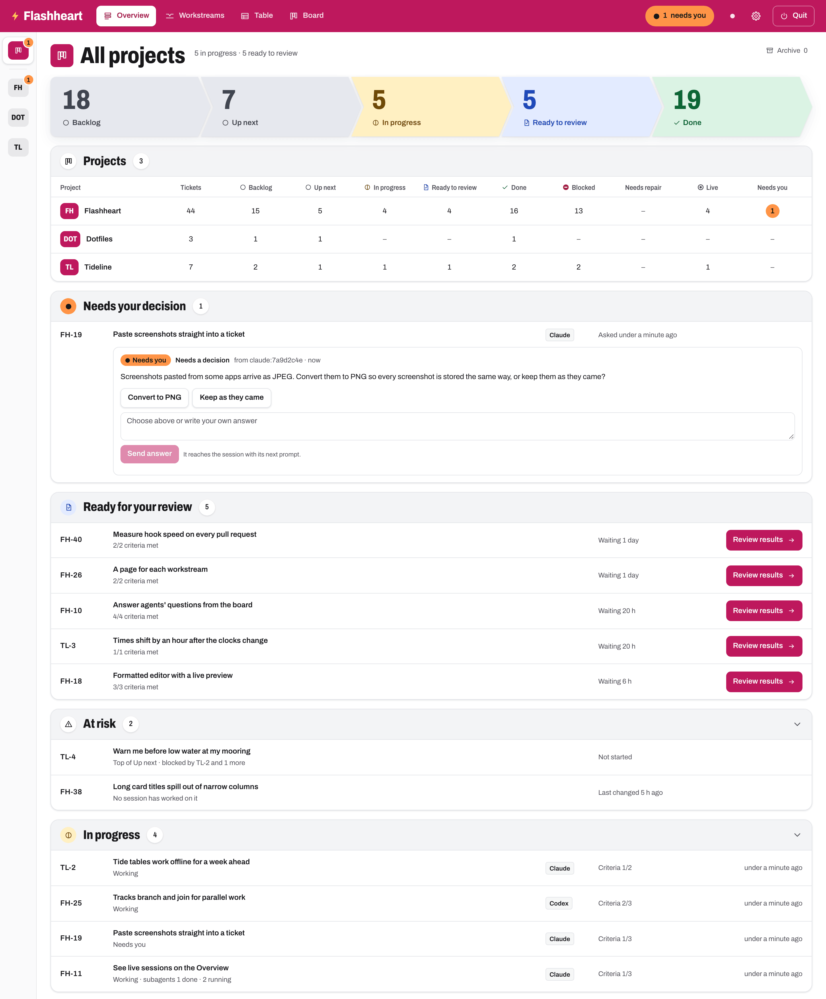
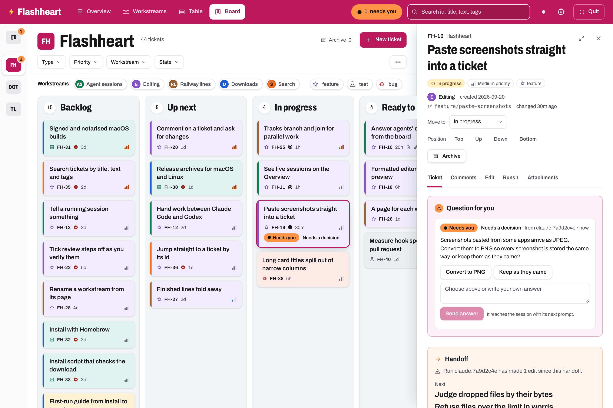
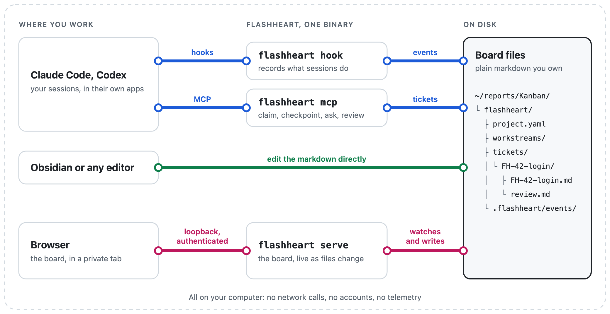

# Flashheart

> *"Woof!"*

**One local kanban board for every project you build with AI agents, that
the agents keep up to date themselves.**

You run Claude Code and Codex sessions across several repositories, often
in parallel and often unattended. Flashheart puts all of that work on one
board: which tickets agents are working on, what is ready for your review
and which sessions are waiting for you. Agents find their work on the
board, tick off acceptance criteria, leave handoffs, ask you questions and
write reviews, on the same tickets you read. When a session dies, runs out
of context or is replaced, the next one (in either agent) picks up the
ticket's handoff and carries on.

It is a single binary that runs on your machine. The tickets are plain
markdown files you own; nothing leaves your computer.


*The board for one project. The rail on the left switches projects; the
orange badge counts the sessions waiting on you.*

## Set up in three steps

1. **Install** the binary for macOS or Linux from the
   [Releases page](https://github.com/rztaylor/Flashheart/releases/latest)
   and put it on your `PATH` ([script](#1-install)).
2. **Connect your agents**, either or both:

   ```bash
   flashheart setup claude
   ```

   ```bash
   flashheart setup codex
   ```

3. **Open the board**, then ask an agent in any git repository to
   *"tackle the two top-priority bugs"*:

   ```bash
   flashheart
   ```

Each step is covered in detail [below](#setup-in-detail).

## Features

### One board across all your projects

Every repository gets its own project with a short ticket key (`FH-42`).
Columns for Backlog, Up next, In progress, Ready to review and Done; a
table view; filters by type, priority, workstream, age and state; search;
and a **Needs you** chip that shows the tickets waiting on you, across
every project. Cards show whether an agent is on them and what it is
doing, when they last changed and what blocks them.

### Workstreams with dependency graphs

Group tickets into workstreams: epics or milestones with a goal. Tickets
and whole workstreams declare what they depend on, and the Workstreams
view draws the plan as a railway map, so you can see what is done, what is
running in parallel, what is blocked and why.


*Stations are tickets; lines are dependencies. "Downloads" waits for two
other workstreams, so its line is dashed and the reasons are spelled out.*

Each workstream has its own page with its graph, goal, scope and success
criteria.


### An Overview of everything that needs you

The Overview is for the project manager in you: the pipeline across every
project, the decisions agents are waiting on, the work ready for your
review, what is at risk (a session gone quiet, work no session is
holding) and the sessions in progress, Claude Code and Codex, with their
subagents.



### Agents that report, ask and hand off

- **Hooks do the bookkeeping.** Each session's start, edits, permission
  prompts, subagents and stop are recorded with no effort from the model.
- **The MCP server does the rest.** The agent finds and claims its ticket,
  ticks criteria as they pass, files tickets for follow-up work and
  checkpoints its progress.
- **Sessions you can lose.** Each checkpoint rewrites the ticket's handoff:
  what is done, what is next, the files that matter and open questions.
  The next session, in Claude Code or Codex, is pointed at it when it
  starts and carries on from it.
- **Questions that reach you.** When an agent needs a decision it asks on
  the board, with its options, and the card lights up as Needs you. Your
  answer goes straight back to a session that is waiting for it, or
  arrives with its next prompt.



### Reviews with evidence

Agents finish by writing a review: a summary, captioned screenshots, steps
to verify and risks, copied into the ticket so they outlive the agent's
worktree. You request changes on the ticket page and the agent picks them
up on its next turn; only you move a ticket to Done.


### Yours, and local

- **Files are the truth.** Tickets are markdown with YAML frontmatter, one
  folder per ticket, readable in any editor or Obsidian and usable without
  Flashheart running. Edits made outside the board appear live.
- **Local and private.** A loopback-only server with authenticated
  requests, no telemetry, no accounts. Hooks never store your prompts,
  commands, or tool inputs and outputs, and text agents write is scrubbed
  of anything that looks like a secret.
- **Light and dark.** The board follows your system theme, or pick one.


*All screenshots are of an invented board, generated by
`scripts/readme-screenshots.sh`.*

## Setup in detail

Flashheart runs on macOS (Apple silicon and Intel) and Linux (x86-64 and
ARM).

### 1. Install

Each [release](https://github.com/rztaylor/Flashheart/releases/latest)
has a `flashheart_<version>_<os>_<arch>.tar.gz` per platform and a
`SHA256SUMS` file. This downloads the right one, checks it and installs it
to `~/.local/bin`:

```bash
os=$(uname -s | tr '[:upper:]' '[:lower:]')   # darwin or linux
arch=$(uname -m)
case "$arch" in x86_64) arch=amd64 ;; aarch64) arch=arm64 ;; esac
version=$(curl -fsSL https://api.github.com/repos/rztaylor/Flashheart/releases/latest | sed -n 's/.*"tag_name": *"v\([^"]*\)".*/\1/p')
file="flashheart_${version}_${os}_${arch}.tar.gz"
curl -fsSLO "https://github.com/rztaylor/Flashheart/releases/download/v${version}/${file}"
curl -fsSLO "https://github.com/rztaylor/Flashheart/releases/download/v${version}/SHA256SUMS"
grep " ${file}\$" SHA256SUMS | shasum -a 256 -c -
tar -xzf "$file" && mkdir -p ~/.local/bin && mv flashheart ~/.local/bin/
```

The checksum line prints `OK`. With `~/.local/bin` on your `PATH`,
`flashheart version` prints the version.

On macOS, if you downloaded the archive with a browser instead, clear
Gatekeeper's quarantine flag once:

```bash
xattr -d com.apple.quarantine ~/.local/bin/flashheart
```

### 2. Connect your agents

`setup` shows its changes as a diff, asks before writing and backs up
every file it writes. Run it again if you move the binary.

**Claude Code** (CLI, IDE extensions and the desktop app's Code tab):
`flashheart setup claude` adds the hooks to `~/.claude/settings.json`,
registers the `flashheart` MCP server for every project (through the
`claude` CLI) and installs the Flashheart skill, which tells the model
when to claim, checkpoint, ask and finish. Start a new session afterwards.
More in [`docs/user/claude-code.md`](docs/user/claude-code.md).

**Codex** (CLI, IDE extension and the ChatGPT app):
`flashheart setup codex` adds the MCP server to `~/.codex/config.toml`,
the hooks to `hooks.json` and the protocol to your global `AGENTS.md`.
Codex runs hooks only once you trust them: run `codex`, type `/hooks`,
trust each Flashheart hook, then start a new thread. More in
[`docs/user/codex.md`](docs/user/codex.md).

`flashheart doctor` checks the result and changes nothing.
`flashheart setup claude --uninstall` (or `codex`) removes Flashheart's
entries and nothing else.

### 3. Open the board

`flashheart` opens the board in your browser and gives you the terminal
back. It stops when you choose **Quit** or close its last tab. Tickets
live in `~/reports/Kanban`; pass `--root` or set `FLASHHEART_ROOT` to
keep them elsewhere.

Then ask in plain words, in any git repository: *"tackle the two
top-priority bugs"*, *"look at FH-42"*, *"pick up where the last session
left off"*. A repository's project appears on the board the first time an
agent works in it.

### Bring your existing todo list

Already tracking work in a `TODO.md`, a roadmap, a tasks folder or
comments in code? [`docs/user/migrating.md`](docs/user/migrating.md) has
a prompt to paste into Claude Code or Codex. The agent finds your
planning, whatever its format, proposes tickets, workstreams and
dependencies, and creates them on the board once you approve. Your old
files stay as they are unless you ask.

## How it works

<picture>
  <source media="(prefers-color-scheme: dark)" srcset="docs/images/how-it-works-dark.png">
  
</picture>

- **Files are the truth.** One folder per ticket
  (`tickets/FH-42-<slug>/`), its column in frontmatter. See
  [`docs/dev/specs/board-format.md`](docs/dev/specs/board-format.md).
- **Hooks do the bookkeeping;** the model only reports what only it knows.
  Hooks are fast, quiet and fail open: Flashheart failing never breaks an
  agent session. The one exception is opt-in: a project can have
  Flashheart ask a session once to checkpoint before it stops. See
  [`docs/dev/specs/agent-protocol.md`](docs/dev/specs/agent-protocol.md).
- **Observe, don't host.** Flashheart coordinates the agents you already
  run in their own apps; it does not run, proxy or supervise them.

## Upgrades

Flashheart is built with Flashheart: its own board runs every day of its
development, so upgrades keep your boards working. Every release reads the
boards earlier releases wrote. If the way agents talk to Flashheart
changes, the agent protocol's version goes up and the release notes tell
you to run `setup` again. See the [changelog](CHANGELOG.md) for what each
release changed and the [roadmap](docs/dev/roadmap.md) for what is next.

## Building from source

Requires Go 1.26.6+ and Node.js 22+ (build time only).

```bash
scripts/build.sh                    # frontend + binary into build/flashheart
scripts/deploy.sh                   # build, then install as ~/bin/flashheart
scripts/package.sh                  # release archives into build/dist (docs/dev/ops/release-governance.md)
scripts/check.sh                    # lint, unit tests, builds, vet, race tests
scripts/e2e.sh                      # Playwright lifecycle, axe and screenshots
scripts/e2e-visual.sh               # screenshot comparison in Docker (--update-snapshots)
scripts/readme-diagram.sh           # render the How it works diagram from docs/images/src
```

The scripts reinstall the frontend packages when `frontend/package-lock.json`
has changed since the last install (see `scripts/frontend-deps.sh`).

## Documentation

- [`docs/SPEC.md`](docs/SPEC.md): what Flashheart is and must do.
- [`docs/dev/roadmap.md`](docs/dev/roadmap.md): delivery order and status.
- [`docs/dev/decisions.md`](docs/dev/decisions.md): why it is built this way.
- [`AGENTS.md`](AGENTS.md): rules for agents working on this repository.

Changes land through pull requests; see [`CONTRIBUTING.md`](CONTRIBUTING.md).
Report security issues as described in [`SECURITY.md`](SECURITY.md).

## Licence

MIT. See [`LICENSE`](LICENSE).
